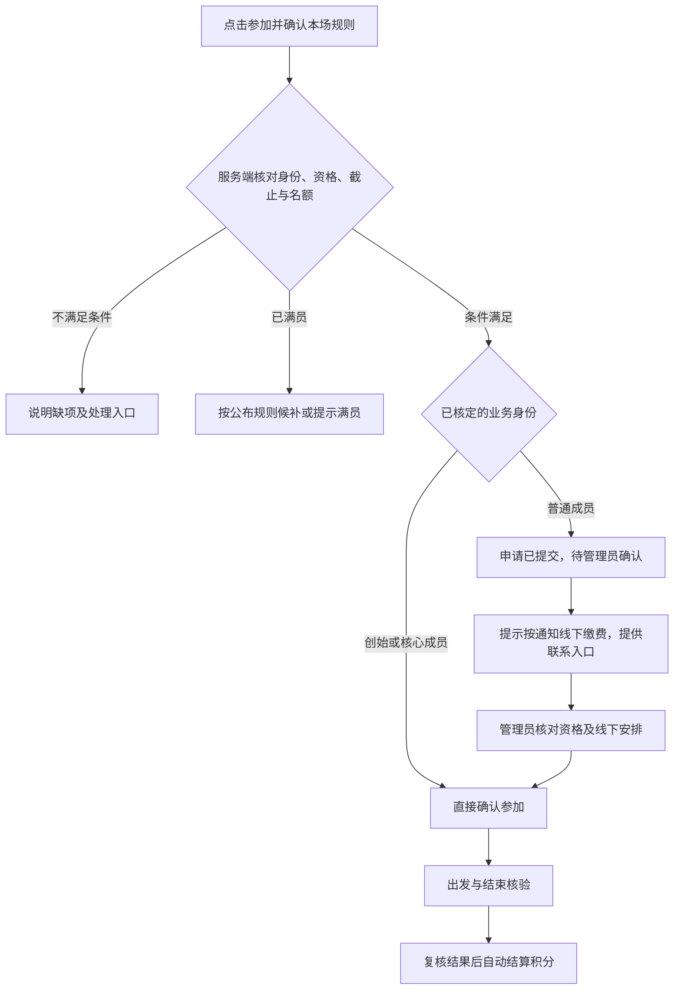

# OR ADV 产品设计与长期迭代稿

版本：设计稿 0.1；更新：2026-10-15。服务对象：原始拉力，一个俱乐部，成员总量200人以内，活动约每月一次或更频繁。

**本文是后续开发依据，不是功能完成报告。** 用户明确补充的业务事实在第一节列出，其余设计均为建议，按内测结果逐轮修订。当前代码、模拟边界和真实云接入状态仍以 [HANDOFF](../HANDOFF.md) 为准。本轮仅研究与规划，不修改产品实现。

## 1. 已确认的业务与设计目标

| 已确认事实 | 对产品的直接要求 |
|---|---|
| 当前主体只有一个俱乐部，有几位创始人，也有新加入的成员 | 保持单俱乐部；增加可信的成员身份管理，暂用“创始／核心成员”和“普通成员”两类业务身份 |
| 总成员200人以内，约每月一场或更频繁 | 能管理完整成员记录；按活动周期评估价值，不以每日打开次数作为主目标 |
| 最头疼的是无组织、无记录，负责人手工统计积分麻烦 | 活动名单、出发结束记录、自动积分和可核对报表优先 |
| 创始成员点击参加后直接报名成功，不经过收款确认流程 | 在身份、资格、规则和名额满足时直接确认参加；不会因此自动发完成积分 |
| 非核心成员点击参加，要提醒缴费，由后台管理员确认报名成功 | 提交申请后明确提示线下缴费安排，管理员核对后确认；本期不接线上支付、不记录金额或缴退款台账 |
| 客户希望核心成员即使分低，也能在默认展示中靠前 | 默认成员展示采用会员身份和俱乐部编排；真实积分、实际完成次数继续可核对 |
| 需要好看、好用的界面，可参考Arco Design，不出现空泛宣传文案 | 中性灰白、橄榄绿、清楚的信息层级；每页说明当前情况和下一步 |

“不经过收款确认流程”描述的是报名路径，不在小程序里扩写成“永久免费”等未确认承诺。创始／核心身份由主理人核定，普通成员不能自己勾选升级；具体对外称谓在发布前确认。

继续保留：真实线下有偿服务、非铺装越野／技能训练／多日穿越、不办比赛、食宿交通自理；积分和会员身份不能代替技能与现场安全核验。公开展示自愿，拒绝展示不影响已有身份权益。

**下一版的目标：一场活动有人负责、名单清楚、过程留痕，活动结束后负责人不再逐人手算积分；老成员的身份能被正确识别，新车友也知道怎样参加。**

## 2. 当前版本的基础与缺口

当前0.1已实现8个原生页面、模拟报名到积分流程、事务与权限领域逻辑；59项自动化测试及微信官方编译预览通过。尚无真实云业务和真实手机验收结论。下面是代码审阅，不是用户访谈结论。

| 现状与证据 | 缺口 | 本轮判断 |
|---|---|---|
| [报名实现](../shared/registrations.ts) 使用通用审核／确认路径 | 没有创始身份分流 | 下一版核心规则，不能只改按钮文案 |
| [会员摘要](../shared/types.ts) 包含积分与员工角色 | 没有创始成员认定、认领与撤销机制 | 增加独立业务身份，避免与后台权限混用 |
| [报名进展页](../app/miniprogram/pages/mine/index.wxml) 提示等待工作人员联系 | 新车友缺少经过验证的联系方式、负责人和处理预期 | 先补齐有效联系方式和确认办法，再增加提醒渠道 |
| [我的活动](../app/miniprogram/pages/mine/index.wxml) 主要显示当前状态 | 已确认后缺少本场准备与集合资料 | 做“本场同行”页，成为参加活动时的常用入口 |
| [员工工作台](../app/miniprogram/pages/staff/index.wxml) 主要是长卡片名单 | 查人、看待办、逐日核对不够高效 | 按活动阶段组织工作，名单可搜索和筛选 |
| [积分服务](../shared/points.ts) 已有结算、冲正与年度归属 | 缺少面向负责人的全员统计、对账和历史迁入工具 | 复用已有流水基础，不新建手工余额表 |
| [内测上限](../shared/limits.ts) 每场30人、年度快照30人 | 不能把200名成员的年度汇总误称已经支持 | 分开验证成员总量、单场人数、年度统计；大名单要分批处理 |
| [活动列表](../app/miniprogram/pages/activities/index.ts) 主要按状态筛选 | 不容易判断适合谁、下一步做什么 | 活动信息结构化，个人行动信息优先 |

200是成员总量，不是已确认的单场人数。下一轮先保留单场30人的内测边界；超过30人的活动需另做容量、现场操作和云事务验收。年度统计则应覆盖全俱乐部成员，不能被单场限制卡住。

## 3. 三类用户，每次打开要办什么

| 用户 | 打开时的问题 | 产品应直接给出的结果 |
|---|---|---|
| 创始／核心成员 | 我的身份认对了吗？这次能直接参加吗？我有哪些安排？ | 可信成员卡、直接确认的报名结果、行前安排、真实活动记录和默认推荐展示 |
| 普通／新车友 | 适不适合我？怎样报名？费用找谁确认？现在算参加成功了吗？ | 清楚的活动要求、申请结果、线下缴费提示、联系入口和管理员确认状态 |
| 主理人／运营／领队 | 谁要处理？谁来了、谁没回来？这场积分怎么算？ | 按阶段的名单与待办、每日核验、异常处理、结算预览、自动积分和差异报告 |

这些角色可以由同一个现实人物兼任，但系统授权分别判断。创始成员不自动成为管理员，管理员也不因为有后台权限获得报名或积分特权。

## 4. 下一轮必须落实的业务规则

### 4.1 两类报名路径

- 业务身份从可信微信账户对应的服务端记录取得，不信任客户端传来的“我是创始人”。
- 创始成员直接确认仍需有可用名额及满足必要资格；不静默挤掉已经确认的普通成员。满员时不显示虚假的报名成功。
- 创始成员取消后重报、候补获得有效名额时，重新核对当前身份、资格与截止；仍符合条件就直接确认，不意外进入普通成员的缴费待确认路径。候补提升本身不代表获得插队权。
- 普通成员看到“申请已提交，待管理员确认”，不使用会被误解为确认参加的“报名成功”。线下缴费说明与确认入口放在申请结果和本场页面。
- 管理员的按钮是“确认参加”；依据线下情况核对后操作。系统不推测付款是否成功，不新增金额、订单号、缴退款状态。
- 如果某场需要专项资格审核，应先完成资格核验再进入可确认路径；不能鼓励不符合条件的新车友先缴费来取得资格。
- 记录报名时身份依据及规则版本。后续身份更正不能悄悄把已经确认的报名改成待缴费；已有参加安排的变更需有原因和人工处理记录。
- 是否为创始成员保留专用名额、是否允许插队、普通申请预留多久，尚未确认。默认不从“优先展示”推导这些权利；现有占位／候补规则调整前须明示并同步事务逻辑。

建议文案：

| 场景 | 页面文案 |
|---|---|
| 创始成员满足条件 | “已确认参加。请查看行前安排。” |
| 普通成员资格已满足且有预留名额 | “申请已提交。请按活动通知完成线下缴费，工作人员确认后方可参加。” |
| 普通成员尚在候补或待资格核验 | “当前尚未确认名额／资格，请等待处理安排。”不直接套用立即缴费提示 |
| 尚未配置有效联络渠道 | 活动发布预检提示运营补齐，不能对外承诺“我们会联系你”却没有联系办法 |
| 缺少技能资格 | “本场需要完成相关技能核验。查看核验方式，或选择入门活动。” |
| 满员 | “本场名额已满。可按本场规则申请候补。” |

### 4.2 成员身份的认定

首版只做足够用的两类身份，不引入未经需要的多层会员体系。主理人管理认定、纠错和撤销，记录操作人、依据与生效时间；身份是否设置到期日由实际制度决定，不自动假定年费续期。

老成员首次用微信进入，可提出“核对我的成员身份”。工作人员通过既有可靠渠道核实后绑定，避免按相同昵称自动认领他人身份。未经核定保持普通成员权限。核对不默认收身份证或证件照片。

会员业务身份、员工权限、技能资格和公开展示同意分别存储。撤销员工授权不应抹去真实活动历史；取消公开推荐不应取消创始身份。

### 4.3 核心成员优先展示，积分保持可核对

建议把默认页面命名为**“俱乐部推荐”**：有效核心成员优先，必要时由主理人编排展示顺序。允许低积分核心成员在这里位于高积分普通成员前面，直接满足客户希望照顾老成员的要求。

同一入口保留“成长积分”“年度积分”“完成次数”排序。这些列表继续按真实记录计算，同分并列。改变推荐顺序不能改写积分流水、有效完成次数或技能资格。

页面说明建议：“推荐顺序由成员身份和俱乐部编排决定。积分排名请切换查看。”推荐列表可以表达成员介绍和展示先后，不使用竞技领奖台暗示其为成绩排名。

运营调整推荐需有记录、版本和撤销方式；不必向公众公开内部操作人或每次调整原因。身份失效或退出推荐后，停止后续公开读取并更新缓存。实际姓名、头像、成员身份的展示范围须明确同意，不能直接复用原有积分榜的开关；不愿被推荐的核心成员仍保留业务身份。

为新人保留正常的活动参与和自愿介绍入口；不要求新人获得与创始人相同的推荐位置，也不让其误以为未被推荐就不能参加。老成员没有可信历史积分时，可认定创始身份，不用编造积分来实现优先展示。

### 4.4 把手工积分变成“确认事实，系统计算”

工作人员负责确认参加事实，系统负责按冻结规则计算：

1. 发布时确认本场的成长／年度奖励及适用条件。
2. 现场按日记录出发、返回、退出、未到等结果。
3. 结束后查看结算预览：可结算人员、分值、异常和未处理事项。
4. 管理员确认结算；逐人事务写入流水、汇总与完成状态，展示批次进度和失败清单。
5. 自动更新个人记录、活动汇总、成长／年度积分与客观榜单。
6. 负责人按成员、活动、年份查询和对账；可取得授权范围内的积分报表，默认不附带电话等无关资料；纠错用带原因的冲正，不直接编辑总分。

创始身份影响报名与推荐，不自动免除出发结束核验，也不自动增加完成分。是否存在额外奖励政策要单独确认并版本化，不能将排序需求藏进分数。

负责人可以逐项核对每人的本场结果与积分。系统对账需同时检查人数、流水业务键、增长总分、年度归属和有效次数。重试只补失败项，不重复发分。年度名单按完整成员集合分批处理，保留一致性版本，不能把200人的数据一次塞进受限事务。

### 4.5 既有积分与历史记录迁入

历史迁入是待实现功能，先做预览再执行：

- 确认现有台账来源、截止日期和负责人；没有原始依据的历史不能凭昵称自动合并。
- 预览成员匹配、重复项、异常值和总计；主理人确认后产生带来源的迁入流水。
- 区分历史成长积分、可确认的年度积分和真实参加次数；年份不明的积分不能全塞入今年，缺少活动依据也不能补造完成场次。
- 每批有唯一标识和行级业务键，重复导入不能重复加分，失败可以追踪和重试。
- 原始实名台账、映射、导出和备份仅在受限环境存放，不能进入公开GitHub。

若暂不迁入，页面说明“历史记录整理中”，保留当前系统新产生的真实记录。不能既显示完整总分，又让用户无法知道来源。

## 5. 留住用户的四个真实时刻

这是设计假设，需要通过实际活动验证，不能承诺功能上线就提高留存。

| 时刻 | 车友得到的实际帮助 | 俱乐部要做的工作 |
|---|---|---|
| 下次活动开放 | 判断是否适合，查看自己的成员身份与参与路径 | 有负责人持续发布真实可组织的活动，补齐要求与联系人 |
| 已申请／已确认 | 知道现在到哪一步、怎样联系、需要准备什么 | 处理申请、及时确认、维护本场须知 |
| 活动当天 | 看集合与当日安排，核对自己的记录 | 领队清点每个人，处理未返回与异常，不能靠热闹页面代替工作 |
| 活动结束及下一场 | 查到自己的经历和积分，找到合适的后续活动 | 完成结算、处理异议、选择性给出技能反馈和后续建议 |

每月一场的产品，不必要求车友每天打开。观察已参加者在后续可参加活动开放时是否再次使用，结合实际活动间隔解释；天气停办、时间冲突、资格不符和产品不好用应分别记录。

创始成员的持续价值包含身份认同和办事方便；普通成员需要看得懂的参与路径与逐步积累的记录。推荐展示、行前实用工具和自动记录可以同时存在，不应只靠积分高低解释一切。

## 6. 页面结构与关键界面

建议结构先做可点击设计，再用真实成员验证，不把下面的Tab调整当作已批准事实：

| 主入口 | 主要内容 |
|---|---|
| 活动 | 近期招募、适合入门的场次、本人当前待办；活动选择信息先于积分数字 |
| 同行 | 已申请、待出发、进行中、已结束，进入本场资料与过程记录 |
| 俱乐部 | 官方介绍，默认推荐成员，切换真实积分与完成次数榜单 |
| 我的 | 成员卡、身份核对、成长档案、组织方联系、隐私，按授权显示员工入口 |

### 6.1 活动首页与详情

首页已有申请时优先显示本人状态与下一步；已确认参加时先显示行前资料。没有申请时展示近期真实招募和入门场次。成员宣传不遮挡需要处理的个人事项。

活动卡片优先信息：日期／天数、标题、公开区域、实际强度和适合人群、剩余名额与截止。积分门槛和技能要求分别表达。详情用能理解的要求说明替代纯数值“难度”：活动形式、预计时长、必要经验和装备由组织方填写，不自动从积分推导安全结论。

没有适合活动时，提供“查看已发布入门活动”或自愿表达活动兴趣；兴趣不占名额，不承诺必定开团。空状态不能靠虚构活动填满。

### 6.2 本场同行

同一页面随阶段变化，顶部始终是状态、下一步和有效联系人：

- 申请阶段：待确认／候补、线下安排说明、联系入口、退出或更正方式。
- 确认阶段：集合信息、负责人、装备准备清单、最新通知和本人的确认情况。
- 进行中：当天安排、本人的出发／返回记录及联系办法。
- 结束阶段：完成结果、积分来源、待处理问题与可发布的回顾。

公开详情只显示非敏感区域。精确集合资料仅给有权参加者，取消后服务端停止后续读取。准备清单、通知已读、报名确认、出发核验和活动完成是不同事实，不能互相替代。

### 6.3 我的成员卡与成长档案

成员卡说明实际身份、适用范围、核对状态和联系办法；本期首先体现直接报名路径，不编造尚不存在的优惠权益。普通成员使用完整、正常的界面，不以大片灰锁制造受排斥感。

成长档案先展示每场经历与积分依据，再逐步增加技能观察：谁在何时核验了什么、是否需复核、下一步可以参加什么。评估项目和有效期由专业负责人确定。没有评估就显示未评估，不自动生成评价或用参加次数兑换技能。

早期反馈采用少量明确观察项与可选短评，先在重点成员中试验；不能让领队每场为200名成员写长篇报告。安全退出保留实际经历，不变相羞辱或鼓励为了积分继续冒险。

### 6.4 员工工作台

从“一个很长的页面”改为“今天需要处理什么”：

- 工作台：授权场次、待确认人数、今日未完成核验、结算异常。
- 本场管理：报名／联系、现场、结果、积分四个工作阶段。
- 单人记录：必要身份核对、成员类别、资格、每天记录、操作原因。

名单支持搜索、状态筛选和重名区分；核验列表按当前待办组织，未返回者和异常人员优先，不按创始身份把其他人藏到后面。普通成员的待确认与创始成员的已确认清楚分组，管理员不再反复翻聊天记录重新统计。

断网或超时不能显示绿色成功。显示“尚未确认写入，可刷新核对”，沿用业务幂等机制重试。第一阶段不承诺离线自动核验；现场人工备用流程由组织方安排。当前代码只接受当日核验，跨日补录尚未实现，必须另行设计发生时间、录入时间、权限、依据与对账后再开放，不能通过改时间绕过检查；未处理清楚的记录不直接发分。

## 7. UI与文案规范

原生微信界面借鉴Arco的层级与反馈方式，不引入网页组件框架。白色卡片、中性背景、克制的橄榄绿；状态用文字与颜色一起表达。真实活动图片由俱乐部提供，暂缺时用简洁版式，避免重复装饰占满屏幕。

每屏围绕一个主要任务；异常、取消、冲正与常规核验拉开距离。长标题、系统大字体、空列表、弱网、重复点击和多人同时操作都纳入验收。

文案写“申请已提交”“待管理员确认”“查看行前安排”“本场积分已结算”“完成记录已更正”。错误说明当前情况、原因与可采取的动作；重要规则和结果不能仅靠一闪而过的提示。该取向参考 [Arco反馈规范](https://arco.design/docs/spec/message) 与 [NN/G状态可见性](https://www.nngroup.com/articles/visibility-system-status/)，不是对留存效果的保证。

## 8. 版本顺序与放行条件

按成果推进，不在缺少云环境、资料和工作量评估时承诺具体上线日期。0.2可分两次交付，先保证一场真实活动能使用，再把完整统计工具补齐。

| 阶段 | 要解决的问题 | 建议交付 | 放行条件 |
|---|---|---|---|
| 0.2a：真实活动与身份分流 | 一场活动组织清楚，核心成员走对路径 | 测试云与真实身份；创始成员核定；两类报名；有效联系；最小本场须知；名单搜索和当日核验；单场自动积分及失败重试；默认推荐与客观积分分开 | 首次用单日活动验证独立微信身份的车友、运营和限场领队；单场不再手算积分；无越权、超额、重复积分，主理人可自行认定身份 |
| 0.2b：全员历史与对账 | 全成员记录完整，累计积分随时可查 | 200人以内成员目录、累计统计和授权报表；完整流水对账；历史迁入预览；年度汇总分批处理 | 覆盖200名虚构成员的统计验证；有可靠旧台账时做迁入试点，没有时不阻塞新记录统计；重复导入／结算／冲正可核对 |
| 0.3：准备与变化 | 少重复解释，安排变化有记录 | 完整准备清单、重要通知、变更版本与必要再确认、按场授权分工；按实际能力接提醒 | 拒绝订阅仍能查状态；变更未确认与资格未核验不被误算成功；两日核验完整 |
| 0.4：成长与再次参加 | 参加后留下有用记录，知道下一步 | 私人经历、技能评估路径、少量领队反馈、可选官方回顾和下一场建议 | 用户能说清积分与技能的差别；有明确评估人与复核依据；工作人员维护负担可接受 |
| 0.5：稳定月度运营 | 每次组织更省事，积累能长期保存 | 活动模板、常规系列、权限审计界面完善、年度奖励管理与恢复演练 | 经过实际场次验证；模板须逐场核实再发布；记录可恢复并对账 |

单场自动积分是0.2a的完整出口，0.2b增加全俱乐部累计统计和历史工具，不能把解决手算问题推迟到后期。0.2a先做单日真实内测；任何版本开放多日招募前，都必须完成逐日真实核验与异常验收，不能等到0.3才补证据。

备份、权限、隐私及实际运营必需条件不能等到0.5才首次处理；后期是在真实内测基础上完善。年度统计属于0.2b，年度奖品发放管理可按运营时点再排。

### 0.2a的具体工作单

| 编号 | 功能 | 验收例子 |
|---|---|---|
| P01 | 可信身份与创始成员管理 | 普通账号不能自升身份；主理人可认定、更正、撤销；业务身份不授予员工权限 |
| P02 | 两类报名分流 | 创始成员初次报名、取消后重报及候补获席时符合条件均直接confirmed；普通成员有适用名额时进入待确认并看线下提示；满员／资格失效不伪造成功 |
| P03 | 默认推荐展示 | 低分核心成员可在推荐页靠前；积分页仍按真实分值；未同意公开者不出现，退出生效 |
| P04 | 本场入口与联系 | 新人能够找到真实联系办法、当前进度和下一步；只有已确认者能读相应受限资料 |
| P05 | 员工按场处理 | 可查找重名成员、筛选待确认／未返回，日核验清楚；撤销场次授权后接口拒绝 |
| P06 | 自动积分的可见结果 | 成员看到活动名称、完成结果和增量；运营可预览并重试；创始身份不自动发分 |
| P07 | 真实云验收 | 新用户零分、跨手机一致、末席竞争、取消重试、重复结算、权限拒绝和榜单退出有实测记录 |

## 9. 需要新增的领域能力与现有基础

以下是待实现的数据职责，不代表集合或RPC已经存在；开发前同步 [状态合同](../contracts/states.json)、[接口合同](../contracts/api-contract.json) 和 [数据合同](../contracts/data-model.json)。

| 能力 | 最少需要记录的事实 | 保持的边界 |
|---|---|---|
| 创始成员认定 | 成员、身份类别、状态、核定者、依据与变更版本，可选期限 | 与staff_roles、qualification分别管理；不能由客户端自报生效 |
| 报名政策快照 | 本场规则、报名时身份依据、实际状态与确认操作 | 与名额在事务中处理；不新增支付订单或缴退款状态 |
| 俱乐部推荐 | 被推荐成员、展示范围、编排顺序、公开同意版本、操作记录 | 与真实积分score分别存储和查询；撤销／退出后公开投影失效 |
| 本场须知与通知 | 活动、资料版本、公开／参加者范围、变化内容和必要阅读确认 | 版本确认不等同技能合格、付款或签到 |
| 全员统计与迁入 | 流水来源、迁入批次、年度、幂等键、对账差异与汇总版本 | 不覆盖原流水；200人统计分批且可恢复 |
| 技能与成长反馈 | 已有资格类型的展示／管理，后续增加授权反馈与复核要求 | 评价真实、有来源；不由积分或会员身份自动生成 |

复用现有事务接口、确定性业务键、冲正、角色、逐日核验和年度版本保护。新增业务不能复制另一套只在前端生效的身份或积分算法。

## 10. 提醒、兴趣与活动供给

先做好站内当前状态，再接官方允许的订阅能力。提醒用于申请结果、必要安排变化和行前事项；不把周周群发或无限期触达作为方案前提。

微信当前文档同时包含弹窗订阅和新版一次性订阅Beta，模板、类目、触发条件与账号能力需实际核对；不能照搬旧教程的固定条数或假定本俱乐部能长期任意推送。参见 [订阅消息总览](https://developers.weixin.qq.com/miniprogram/dev/framework/open-ability/subscribe-message-overview.html) 与 [订阅接口](https://developers.weixin.qq.com/miniprogram/dev/api/open-api/subscribe-message/wx.requestSubscribeMessage.html)。新能力不构成本项目接入支付的理由。

用户不订阅也可查看正确结果；通知发送失败不能回滚已正确提交的报名。落地时通知去重、状态更新与失败重试分别处理，不把已读等同对活动条件的同意。

活动兴趣仅表达意向，例如想参加入门练习或多日活动，不预占名额、不承诺开团。组织方确认真实能力后发布。每次复制模板都要重新核实时间、人员、天气及必要安排，避免自动发布不可履约的活动。

## 11. 验证是否有用，而非只增加页面

当前没有实际行为基线，也未做访谈。下面的样本和目标是建议，不是已有数据或行业达标线。

建议首轮邀请：2名创始／核心成员、2名熟悉俱乐部的普通成员、2名新车友，加运营和领队共约8至9人；兼任角色记录实际人数。先观察旧版完成相同任务，再测新设计，不提示按钮在哪里。小规模分轮研究的做法参考 [GOV.UK研究计划指南](https://www.gov.uk/service-manual/user-research/plan-user-research-for-your-service)，不拿小样本推算全体留存率。

| 要验证的事 | 任务与观察 | 建议通过条件 |
|---|---|---|
| 核心成员走对流程 | 识别身份、申请、查看已确认安排 | 符合条件时直接确认；普通账号伪装核心失败；满员和失效资格有正确反馈 |
| 新人理解普通报名 | 找合适活动，申请后说明何时才算确认参加 | 六名车友中至少五名无需提示完成主要查找；每人正确判断自己的结果，并能解释创始直接确认与普通待确认的差异 |
| 推荐与积分能解释 | 同看低分核心、高分普通的两种展示 | 能说清默认推荐与积分排序的不同，没有虚构积分或公开未同意信息 |
| 负责人不用手算 | 从现场结果执行结算，处理一次失败与一次纠错 | 正常流程不需逐人输入总分，重试不重发；可对出每人每场的来源 |
| 现场有组织 | 指定场次找人，处理未到、退出和未返回 | 领队能发现未处理人员；单日返回不误完成多日活动；网络失败不假成功 |
| 全员记录可靠 | 使用200名虚构成员跨年、迁入、对账 | 分页无漏重、批次可恢复；年度快照不受原30人上限误导 |

真实内测只使用主理人已核定的活动与政策。若技能管理尚未就绪，先选不依赖额外系统技能认证的适用入门测试活动，仍由现场负责人完成必要资格和安全判断，不开放一个没有核验路径的进阶招募。

## 12. 指标与观察周期

先记录现状，再比较同类活动；每项都显示人数、分母、时间窗和活动条件。小样本写“5/6”，不包装成稳定的转化率或显著提升。

| 指标 | 如何解释 |
|---|---|
| 活动结算的人工作业 | 记录逐人手填／核对所需分钟与步骤，观察自动统计是否真实减少工作；没有当前分钟数，不先编节省比例 |
| 记录与积分差异 | 名单、核验、有效完成、流水、汇总是否一致；差异必须定位与处理，不能只看总数接近 |
| 报名确认理解 | 用户能否区分已提交、待管理员确认、已确认参加，以及联系谁 |
| 必要准备与通知 | 已确认者能否找到资料，重要变更是否处理；页面打开不等于读懂或完成安全核验 |
| 后续合适活动再次参加 | 对已经参加、后续又有资格匹配活动开放的人观察再次报名／完成；同时记录时间冲突、天气取消等原因 |
| 创始与普通成员分别反馈 | 核心身份是否准确、权益路径是否兑现；普通成员是否知道如何参与，而非将两群人平均后看不见问题 |

至少跨两个实际活动周期观察复用；按当前频率通常需跨月，不能在几天内宣布留存改善。报名机会只按已知资格匹配计算，不能假设用户时间一定合适。没有发布合适活动时，不把未回访直接算作产品流失。

早期用少量、目的明确的业务事件与授权运营记录，优先人工归类重复问题。不要读取或上传微信群聊天来做分析，也不默认加入第三方追踪SDK。日活、使用时长、连续打卡、分享拉人和为了积分多参加，不作为主要目标。

## 13. 运营责任与未知项

| 谁负责 | 必须提供或完成 |
|---|---|
| 主理人 | 核定创始名单、成员称谓、现有历史积分来源、活动积分与名额政策、实际联系渠道、活动与运营负责人 |
| 运营 | 发布及联系、普通成员确认、提醒和变化维护、结算预览、异常处理；记录实际人工作业 |
| 领队／核验员 | 授权场次的人员清点、逐日事实与异常，不任意改积分或会员身份 |
| 开发 | 真实云接入、规则实现、权限／事务／对账、原生体验、必要测试、明确模拟及真实验证范围 |

真实测试云EnvId和云授权仍未取得；开发者身份、AppID、上传密钥和官方预览不等于拥有云资源部署权限。

开发前尚需落实：每场人数与积分；创始身份由谁认定及是否会更正；普通成员联系与管理员确认的实际操作；是否保留创始名额、候补和占位政策；历史积分是否有可用台账及年度依据；哪些技能需专业核验。用户已确认的两类报名路径不再重复作为未知问题提问。

本期继续不引入小程序线上支付、金额台账、储值、积分兑换、开放帖子评论私聊、持续GPS或公开精确线路。多俱乐部已由用户明确排除。以后有真实新需求时单独评估，不作为“功能丰富”的默认方向。

## 14. 同类产品与资料研究

检索日期：2026-10-15。资料证明某种机制或规范存在，不能证明它一定改善OR ADV留存。公开产品说明可能为营销材料；没有开展竞品账号内实际操作或车友访谈，不宣称已做。

| 来源 | 可确认的机制／适用边界 | 对本项目的判断 |
|---|---|---|
| [REVER 2024产品回顾](https://www.rever.co/post/rever-rewind-2024-improvements-and-new-features)，2024-12-20 | 活动和骑行资料集中，参加意向与社区入口；属于历史版本说明 | 借鉴稳定的本场入口，不据此扩展全国路线或开放社区 |
| [Strava俱乐部活动](https://support.strava.com/en-us/articles/15401898-how-do-i-create-and-manage-group-events-for-my-club)，当前帮助页 | 参与前说明活动条件、名额等；该页活动模型限一天 | 借鉴判断是否适合的信息；OR ADV继续保留自己的多日核验 |
| [Strava活动运营](https://partners.strava.com/resources/how-to-run-your-club-events-on-strava)，未标日期 | 常规系列、提醒、规则变化确认、活动后记录关联 | 借鉴组织连续性与版本记录；不照搬其协议、保存政策或GPS完成证明 |
| [BMW Motorrad Off Road Skills](https://www.bmw-motorrad.co.uk/en/world-of-bmw/Off%20Road%20Skills%20.html)，未标日期 | 分级学习，基础后有练习／复习与再进阶路径 | 给缺资格用户明确下一步；自有资格不冒充外部认证 |
| [Rapha Chicago骑行FAQ](https://events.rapha.cc/rapha-chicago)，未标日期 | 新人说明、准备要求、领队与收队分工；页面另含场所关闭通知 | 仅借鉴已公布的组织方式，不声称该地点当前仍运营，也不照搬自行车处置细节 |
| [Rapha RCC会员说明](https://www.rapha.cc/us/en/product/rcc-membership/RCCSUB2)，未标日期 | 会员有明确身份、常规活动和专属服务入口 | 身份权益可以独立于运动积分；其服务、保险、住宿与价格不是本项目承诺 |
| [Strava Clubs](https://support.strava.com/en-us/articles/15402172-clubs-on-strava)，当前帮助页 | 俱乐部成员管理与基于活动统计的榜单是不同能力 | 支持将成员推荐与客观统计分开；不照搬竞速或周榜规则 |
| [GOV.UK研究计划](https://www.gov.uk/service-manual/user-research/plan-user-research-for-your-service)，2016原文 | 将假设变成研究问题，按用户群分轮测试 | 作为研究方法，不作为当前市场数据；先形成基线再排更大范围 |
| [NN/G状态可见性](https://www.nngroup.com/articles/visibility-system-status/)，2018原文 | 明确状态与反馈帮助用户知道下一步 | 用于申请、核验和结算交互，不引用为留存提升幅度 |
| [Arco Message](https://arco.design/docs/spec/message)，当前规范 | 操作反馈应清楚、简短并给出指引 | 重要结果持久可查，轻提示不替代正式业务状态 |
| [微信订阅消息总览](https://developers.weixin.qq.com/miniprogram/dev/framework/open-ability/subscribe-message-overview.html)与[接口](https://developers.weixin.qq.com/miniprogram/dev/api/open-api/subscribe-message/wx.requestSubscribeMessage.html)，当前官方文档 | 有多种订阅机制、实际开放条件与版本限制 | 按账号能力验证提醒；不依赖任意长期群发，不因新接口引入支付 |

## 15. 设计稿维护方式

本稿是产品方向与版本排序的主文档；具体接口、数据、状态和验收继续放在现有合同与专题文档中，避免维护两套事实。

每轮结束追加：实际使用的角色与人数、卡点、处理前后的运营步骤和耗时、保留／调整／取消的设计，以及下一轮最小范围。已确认业务、设计建议、已实现、已在真实环境验证分别标记。未经验证的效果不能改写为客户认可或留存已提升。

下一步先画并评审四组界面：成员身份与认定、两类报名结果、本场管理与结算、俱乐部推荐与真实积分。然后按0.2a落实必要真实云接入和可操作流程，再扩展0.2b的完整统计与历史迁入。
