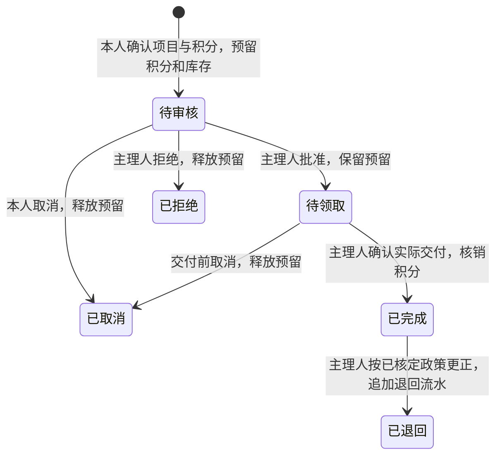

# 0.4 权限、积分与俱乐部兑换设计

**状态：领域后端已实现，原生流程与受控验证推进中。** 兑换默认关闭、项目默认草稿，由最高管理核定后自行发布；不自动向真实账户发放历史兑换积分。本文记录业务边界、数据结构和验收条件，不作为实际发分、扣分或部署验收的证明。当前成长／年度积分及报名基线见 [积分规则](04-points.md)、[产品设计](20-product-design.md)。当前兑换咨询保留为咨询记录，不能直接转换成扣分申请。

## 1. 已确认与待确认

| 项目 | 状态与处理 |
|---|---|
| 积分用于兑换俱乐部物品或服务 | **用户已确认**，据此设计真实兑换流程 |
| 0号主理人与1号车队经理均拥有最高业务管理权限 | **用户已确认**；两者使用有效 owner 授权，designation 只区分展示称谓；编号、开发者身份或公开职责不授予权限 |
| 创始成员符合条件直接确认参加，普通成员线下安排后由管理员确认 | **现行已确认规则**；仍需满足名额、成长门槛、资格和安全要求 |
| 准入、活动计分、累计、消费和排名形成闭环 | **本轮目标**；具体分值、兑换价格和历史换算尚待核定 |
| 成长积分不因兑换减少；年度积分按实际完成年累计 | **建议沿用**，避免兑换后失去活动准入或年度成绩 |
| 新活动默认兑换奖励等于成长奖励，发布前可调整 | **本轮实施方向**；明确写入新活动冻结规则及政策版本，旧已发布活动缺少该字段时一律为 0 |
| 先预留、交付时扣分；未交付可取消 | **建议首版流程，未确认**；明确展示预留与实际扣除的区别 |

不新增金额、缴退款、支付、储值、交易或提现字段。积分兑换不改变现有活动线下安排，也不自动授予技能资格、员工权限或创始身份。**不自动换算历史真实积分，不自动为真实账号补兑换余额。**

## 2. 积分各自负责什么

| 记录 | 来源 | 用途 | 兑换影响 |
|---|---|---|---|
| 成长积分 | 有效完成流水及其冲正 | 累计成长、报名门槛、成长榜 | 不扣减 |
| 年度积分 | 活动实际完成时间所属北京时间年度 | 年度榜、年度奖励核对 | 不扣减，不跨年搬移 |
| 有效完成次数 | 未被冲正的真实完成记录 | 经历、完成次数榜 | 不扣减 |
| 可兑换余额 | 经政策核定的兑换积分收入、消费及退回 | 物品／服务兑换 | 核销扣除，退回追加流水 |
| 预留积分 | 尚未交付的有效兑换申请 | 防止重复使用同一份积分 | 取消／拒绝时释放 |

例如：某成员成长 600、年度 400、可兑换余额 300。申请兑换 100 分物品后，可用 200、预留 100；交付后余额 200、预留 0。成长 600、年度 400及客观排名均保持原值。

准入继续读取成长积分，报名本身不扣分。创始成员的直接确认不免除完整核验，也不自动发完成分。推荐展示可以按已核定身份和编排靠前；积分榜继续按真实积分／次数排序、同分并列，不通过虚增分数实现推荐优先。

## 3. 兑换流程

首版建议每次申请一个项目、一件物品或一次服务；项目必须有明确积分数和有限库存／服务名额。多件、无限库存、积分转赠、自动超时取消和部分退款另行设计。

- 下单前展示名称、物品／服务说明、所需积分、可用积分、可用名额和交付方式；点击确认才建立申请。
- 申请即预留，不以“审核通过”冒充已交付。物品领取或服务实际提供后，主理人核对本人及申请，明确确认核销。
- 交付前取消／拒绝同时释放积分和库存，一笔申请最多释放一次。交付后成员不能按普通取消处理。
- 首版建议仅支持主理人带原因的整笔退回，引用原消费流水；不删除原核销。是否恢复物品库存须核实实际退回情况，不能仅因积分退回就自动增加库存。
- 归档项目停止新申请，已有申请继续按冻结的名称、积分、数量和政策版本处理。修改项目价格不改变旧申请。

## 4. 权限边界

本节的“最高管理”包括主理人和车队经理，两者均由服务端有效 owner 授权获得能力。可信 primaryOwnerMemberId 另有防锁死保护，不因称谓相同而允许互相取消该保护。

| 能力 | 普通／创始成员 | 最高管理 | 运营 | 领队／核验员 | 内容管理员 |
|---|---|---|---|---|---|
| 查看已发布兑换项目 | 可以 | 可以 | 可以 | 可以 | 可以 |
| 查看余额、提交、取消本人申请 | 仅本人 | 本人走相同规则 | 仅本人 | 仅本人 | 仅本人 |
| 项目、库存、政策、兑换审核与核销 | 不可以 | 主理人／车队经理均可以 | 默认不授予 | 不可以 | 不可以 |
| 活动计分与结算 | 不可以 | 可以 | 按现有有效授权 | 仅记录授权场次事实，不任意发分 | 不可以 |
| 完成分冲正、兑换退回 | 不可以 | 带原因、版本与审计 | 默认不授予 | 不可以 | 不可以 |
| 员工授权和权限收回 | 不可以 | 依角色管理规则 | 不可自升 | 不可自升 | 不可自升 |

最高管理体现为维护政策、授权、核对事实和处理异常；不提供直接修改总分、删除流水或绕过库存的入口。手工赠分、历史补录或额外奖励必须另有用户指令、来源和核定流程，不能从“最高管理”推导为本轮默认功能。

每次写入在事务中检查可信微信身份、有效用户、俱乐部、角色／范围、记录归属、状态与版本。本人即使是主理人，兑换也不能绕过余额和库存规则。公开同意继续独立管理；可用余额、消费记录和兑换内容不进入公开榜单。

## 5. 数据与索引提案

复用 `points_ledger` 保存成长／年度完成分和冲正，复用 `audit_logs` 记录管理行为。新增以下 **5 个集合**，不把消费事件塞入现有完成分流水：

| 集合 | 关键记录与边界 |
|---|---|
| `points_accounts` | 俱乐部＋成员的固定 ID；兑换余额、预留、限制状态、revision、迁移状态。汇总必须能由流水重建 |
| `points_wallet_ledger` | 不可覆盖的收入、收入更正、预留、释放、核销、退回；含余额／预留增量、来源、操作人、发生与记账时间、业务键和关联原流水 |
| `points_policy_versions` | 当前指针及不可覆盖的已发布版本；新活动默认奖励方式、是否开放兑换、审批人、有效范围与内容摘要 |
| `redemption_catalog` | 物品／服务、积分、库存总量／预留／已交付、排序、发布状态；offerVersion 冻结价格／内容，revision 保护库存与编辑 |
| `redemption_requests` | 本人稳定提交标识、请求摘要、项目与积分快照、状态、预留引用、处理记录、版本；快照字段建立后不可改写 |

建议新增 **4 个业务索引**，按实际查询回读确认后纳入下一版数据库计划：

| 集合 | 索引字段顺序 |
|---|---|
| `redemption_catalog` | clubId、status、sortOrder 升序、id 升序 |
| `redemption_requests` | clubId、memberId、createdAt 降序、id 升序 |
| `redemption_requests` | clubId、state、createdAt 升序、id 升序 |
| `points_wallet_ledger` | clubId、memberId、recordedAt 降序、id 升序 |

账户、政策、来源入账及单次预留／核销／释放／退回采用确定性 ID，无需猜测性的唯一索引。所有新增集合继续客户端 `read:false/write:false`，只经鉴权云函数访问。列表每页最多 20 条，按成员和状态索引读取，不一次遍历全俱乐部流水。

现有 v3 初始化工具只适用于空库，**不得对已有业务环境重新执行**。后续须有单独的增量迁移：核对原集合／索引和拒绝规则，只增加批准的新结构，保留现有记录，读回确认；结构部署状态以独立执行及回读记录为准，本文不替代该证据。

## 6. 事务、不变量与幂等

建议账本以 `balanceDelta` 和 `heldDelta` 分开表达：预留只增加 held；释放只减少 held；核销同时减少 balance 和 held；退回增加 balance。

1. 积分、数量及计算结果使用安全整数；单价大于 0。正常申请满足 `balance - held >= cost`，库存满足 `total - heldStock - fulfilledStock >= quantity`。
2. 本人申请在一个事务中写入申请快照、预留流水、账户预留、库存预留及审计；缺少任何一步都不显示成功。
3. 核销在一个事务中校验有效预留，更新状态、账户、库存及唯一核销流水。批准仅改变状态，不扣积分。
4. 取消／拒绝与核销竞争时，只能有一个合法状态迁移成功；后到操作刷新版本，不能重复释放或扣除。
5. 来源入账 ID 以原积分流水为唯一依据，**不把政策版本放进唯一键来重复赠分**。政策版本是来源证据，政策调整另走明确的更正记录。
6. 成员提交标识独立于 RPC requestId，绑定成员、项目、项目版本和数量摘要。相同标识及内容返回原申请，内容变化必须拒绝；未知结果保留原标识与原内容，先查询原申请。
7. 禁止先读余额再在事务外扣分；禁止用截成零掩盖余额或库存错误。对不上账时停止相关操作并给出可核查记录。
8. 沿用事务适配器的顺序执行、排空与有限冲突重试；提交结果不明不当作失败重放，不跳过限流或放宽规则。

**完成分已被消费后发生冲正：** 成长／年度事实仍须更正，不能为保住余额拒绝纠错。建议兑换账户保留可为负的净余额，单独显示待核对差额；可用额始终为 `max(balance-held, 0)`，同时保留实际 balance，不能隐藏不足。出现负余额或预留不足时限制新兑换与核销，由主理人逐笔取消／释放或更正；不自动制造额外积分，也不形成现金收款或追缴。该异常政策仍需核定。

## 7. 获取、累计与历史换算

- 已发布活动冻结准入、完成奖励和适用积分政策；结束核验后按有效完成逐人结算。新增兑换收入与原完成流水在同一事务提交，不修改成长／年度账本含义。
- 未配置积分政策时，新草稿兑换奖励为 0；政策配置后，省略新奖励才按已核定的 growth／zero 默认方式生成。新活动在发布前明确 `pointsRule.redeemable` 与 `pointsRule.walletPolicyVersion`；建议默认兑换奖励等于成长奖励，允许调整为其他非负整数。旧活动缺少字段时为 0，不能因开关或部署时间推定为 1:1。原完成分冲正仅扣回原本真实入账的兑换奖励，不能重复扣回。
- 年度继续采用 Asia/Shanghai 的实际完成年；兑换或退回发生在新年，不改旧年度成绩。流水同时区分来源发生时间与本次记账时间。
- 历史真实积分换算不进入本轮自动流程。未来若用户单独批准，再提交来源、政策版本和换算预览并逐成员处理；年份不明不补造当年成绩，缺少证据不补造参加次数。
- 历史换算期间账户标记为核对中，暂不开放消费。原完成与冲正均须覆盖，逐笔确定性收据防止与实时结算重复入账；最终用源汇总 revision／对账结果确认完整后才激活，不能让“先导入正分、稍后补冲正”的中间余额可被消费。
- 带 `fixtureOnly`／独立样例来源的云记录默认排除历史真实换算；不把既有样例分数赠给真实微信账号。测试需要真实账户积分时，须来自真实结算或另有明确测试授权。

## 8. 接口与页面实施范围

沿用现有 RPC 风格，以下接口已在领域服务实现；云部署及原生验收单独记录：

| 接口组 | 行为 |
|---|---|
| `points.wallet / policy` | 本人摘要、余额、预留、限制／核对状态和分页流水；公开政策仅含核定规则及版本 |
| `redemption.catalog` | 已发布项目最小投影，含积分、可用库存和版本；可用 itemId 定点核对，草稿／归档不返回 |
| `redemption.request / get / mine / cancel` | 本人确认申请、按原 submissionId 查询未知结果和取消未交付申请 |
| `staff.redemption.catalog.get / save / publish / archive` | 最高管理维护项目；新建草稿按 submissionId 幂等，改价不改旧申请，库存总量不能小于已占用量 |
| `staff.redemption.list / get / approve / reject / fulfill / refund` | 最高管理按状态处理并留痕；每次状态变更带版本，异常／退回带原因 |
| `staff.points.policy.get / save` | 最高管理查看及保存政策，每次有效修改形成新版本；不提供任意 setBalance 入口 |

兑换开关只控制新申请，关闭后保留已发生收入、账本及取消／核查能力；不能抹去已发布活动的奖励承诺。活动的新兑换奖励写入规则后冻结，不能用全局开关追改旧场次。

个人积分页清楚区分成长、年度、可兑换、预留；积分明细标出活动来源和兑换去向。兑换页从已发布项目进入确认，再查看本人申请和处理状态；原兑换咨询继续可查，未经本人确认不迁成申请。主理人有待审核、待交付和异常待核对列表。

首次加载优先使用一份服务端摘要，避免连续调用 identity.me。只合并同一可见周期和同一 mode／AppID／EnvId 的未完成读取；离开后重新进入、身份／环境改变必须换代。写入、独立重试和确认弹窗后重新核对；私人草稿及未知结果标识按环境＋成员隔离，失败不得展示成功。无需先采集地址、证件或健康资料；初版采用既有联系渠道核对领取／服务安排。

账号停用／注销申请立即停止新兑换与受限访问；待处理预留交由最高管理拒绝释放，不能因账号已停用把库存永久锁住。必要账本保留，不重新开放该账号来完成清理。

领域实现位于 `shared/points-wallet.ts` 与 `shared/redemptions.ts`。测试覆盖真实结算入口与冲正、未知提交恢复、末件与余额竞争、取消和核销竞争、重复退回、故障事务回滚及随机状态序列对账；通过本地测试不能代替真实云事务或真机体验验证。

## 9. 实施顺序与验收

| 阶段 | 可审查产物 | 验证出口 |
|---|---|---|
| A：规则核定 | 本设计、兑换政策／权限表、项目和库存清单 | 区分已确认与建议，未擅自给真实账户发分 |
| B：领域账本 | 新积分账户／流水与兑换领域模块；与原结算、冲正的事务衔接 | 随机状态序列可对账；重复来源只入账一次；不改变成长／年度结果 |
| C：库存与申请 | 项目快照、预留、审核、核销、释放和整笔退回 | 同余额抢购、末件竞争、取消／核销竞争均无超扣或负库存 |
| D：权限与原生页面 | 本人钱包、兑换及主理人管理，错误／未知结果恢复 | 越权／角色撤销／换人／换环境／迟到响应失败测试；真实操作可完整走通 |
| E：结构与迁移 | 增量数据库计划、拒绝规则、版本和换算预览 | 不跑空库初始化；原记录不改写；样例与真实来源分开；旧客户端仍可读原积分 |
| F：受控内测 | 本机全流程、隔离技术记录并发验证、经授权的真机记录 | 至少覆盖重复请求、真实库存和余额变化、跨年、收入冲正后不足、退回及失败恢复 |

必要反例包括：重复点击不生成两份预留；价格变化要求刷新；撤销角色不能核销；拒绝／取消不重复返还；重复退款不增加余额；没有完整核验不发完成分；兑换后成长／年度榜不下降；退出公开展示不影响本人账本。

开放兑换前先完成历史核对或明确只适用的新政策范围。出现问题时先暂停新申请，仍允许授权取消／释放和核查，保留账本。已产生消费或预留后，不能通过删集合、恢复旧余额或退回旧后端来回滚。

## 10. 下一步需要主理人核定

1. 核定成长不扣、年度不扣、兑换单独记账的具体说明；新活动兑换奖励在发布前明确，历史真实积分保持不自动换算。
2. 首批物品／服务、所需积分、真实库存／名额和交付方式；积分并不自动保证可兑现。
3. 交付前取消、交付后整笔退回、是否恢复库存，以及待核对差额的处理办法。
4. 是否需要兑换有效期；首版建议无自动到期扣除、不自动罚分。
5. 是否向其他运营人员授予兑换管理；首版仅主理人与车队经理，不从其他员工角色自动继承。

持续完成领域逻辑、原生流程、并发对账和受控云验证；具体积分、库存及兑换开关由主理人或车队经理在发布前核定。
